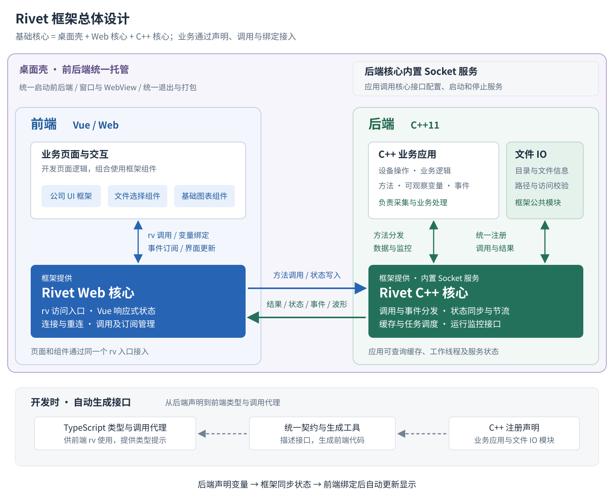

# Rivet 框架概要设计

版本：V0.2 沟通稿 · 2026-09-16

## 1. 建设目标

面向 C++ 上位机项目，以 C++11 处理设备和业务逻辑，以 Vue / Web 绘制界面。通过框架统一处理通信、类型生成和状态同步，减少接口、变量刷新与 UI 接入的重复工作，让开发者主要关注业务和页面交互。

后端按约定声明方法和可观察变量，前端通过 `rv` 调用和绑定；变量变化后自动同步并更新显示。文件选择、基础图表和公司 UI 框架均纳入功能范围。

具体功能、交付节点、维护规则及工时报价见 [框架需求](Rivet框架需求.md)，本文说明模块组织与设计要点。

## 2. 总体设计

### 2.1 基本概念与核心思想

Rivet 将桌面运行环境、界面接入和后端接入组织成一套可复用的开发基础。业务应用在此基础上编写页面、设备操作和业务逻辑，通过声明方法、变量和事件连接前后端。

- **桌面壳**：属于框架基础核心，统一托管前端界面和后端程序，提供桌面窗口、WebView、前后端启动与退出协调，以及桌面打包入口。用户启动一个桌面应用，即可同时启动前后端。
- **Web 核心**：运行在前端，通过 `rv` 提供调用、变量绑定和事件订阅，将后端数据变化转为页面更新。
- **C++ 核心**：接入业务方法、可观察变量和事件，处理调用分发、状态同步、节流与缓存，并向应用提供运行监控接口。
- **组件与工具**：文件选择、图表和公司 UI 基于上述基础复用；契约工具连接前后端声明，Skill 辅助开发。

核心思想是**业务按约定声明能力，框架完成连接与同步，界面通过绑定使用数据**。壳、Web 核心与 C++ 核心各自保持清晰边界；更换壳时，业务接入及文件、图表组件继续通过 Rivet 工作。前端也可在浏览器中运行。

### 2.2 架构与数据流向

图中桌面壳是包含前后端的外层托管容器，统一管理启动和退出；内部左侧为 Web 前端，右侧为 C++ 后端，深色区域为两端核心。实线表示运行时交互，底部虚线表示开发时的契约生成流程。

**运行方式**：桌面壳统一托管前端与后端，一次启动加载两端。C++ 应用初始化核心并启动内置 Socket 服务，前端待服务就绪后连接；退出时由壳协调服务停止和后端进程回收。

**模块组织**：C++ 核心负责调用分发和状态调度，通过内置 Socket 服务收发数据；业务应用负责设备与算法，文件 IO 作为框架公共模块注册。Web 核心提供统一访问入口；文件、图表和公司 UI 分别组织为组件包或模板工程，通过 Rivet 自身接口组合使用，不依赖特定桌面壳。

**数据流向**：前端调用和状态写入经 Web 核心传入 C++ 核心，再分发至业务或 IO 模块；结果、状态、事件与波形反向返回。契约与 TypeScript 代理在开发时生成，供前端编译和调用使用。

### 2.3 Socket 服务的提供方式

**建议由 C++ 核心内置 Socket 通信服务，应用通过框架接口配置、启动和停止。** 核心负责监听、连接管理、消息收发及通信线程，应用注册业务能力并处理业务逻辑，接入时无需自行实现一套服务。

桌面壳统一启动后端和前端：后端初始化时启动核心服务，前端待服务就绪后建立连接；退出时由壳协调前端关闭、核心服务停止及后端进程退出。核心提供监听地址、端口和服务状态接口，方便应用配置及定位启动问题。

## 3. 功能模块设计

### 3.1 桌面壳与应用托管

交付一种默认桌面壳，每个应用实例托管一个前端窗口和一个后端程序，负责窗口、WebView、后端程序启动、连接地址配置及统一退出。一次启动加载两端，服务就绪后连接；关闭时通知后端停止核心服务并回收进程。完成桌面壳运行与打包接入，文件与图表组件通过 Rivet 工作，便于替换壳。

### 3.2 C++ 核心与 Socket 服务

由 C++ 核心内置 Socket 通信服务，面向本机前后端连接，提供配置、启动、停止和状态查询接口。核心管理监听、连接、消息收发、独立通信线程及资源释放；应用只需注册业务并调用框架接口。明确通信线程与业务回调的调度、对象生命周期和退出顺序，依赖兼容 C++11 及目标平台。

### 3.3 C++ 业务接入与状态同步

以显式注册接口和可观察变量包装描述方法、状态、事件及类型；支持数值、布尔、字符串、一维列表及显式注册结构体，只读与可写状态分别处理。首次连接及重连发送状态快照，高频当前值按周期合并并送达最终值。命令、事件和波形分别处理，明确缓存上限、超限策略及断线处理方式；设备采样、原始数据存储和业务算法由应用负责。

### 3.4 Web 核心

提供 `rv` 方法调用、响应式变量及事件订阅，管理连接、重连、错误反馈和订阅释放。Web 核心面向业务页面及组件提供稳定接口，图表和 UI 依赖放在对应组件或模板中。

### 3.5 契约生成与开发工具

由 C++ 注册信息导出统一契约，再生成 TypeScript 类型和调用代理；注册信息同时服务于运行时分发与契约导出。提供生成更新命令、声明诊断及工程配置，明确类型映射和版本更新流程。C++ 声明与契约导出机制需结合甲方业务样例验证。

### 3.6 文件 IO 与选择组件

后端提供目录浏览、文件信息、筛选、路径校验和访问范围配置；前端提供文件单选／多选及目录选择。通过 `rv` 返回后端机器可访问的路径，文件内容读写与转换由业务处理。

### 3.7 基础图表组件

选定一种成熟图表库，封装为独立 Vue 组件包；通过 Rivet 批量接收波形，管理滚动窗口、有限缓存和刷新调度。提供二维多曲线、坐标轴、基础缩放、曲线显隐和暂停／恢复显示，暂停显示与设备采样分别控制。

### 3.8 公司 UI 框架

提供统一主题、主布局、导航、连接／设备状态区，以及设备概览、参数配置、数据监控三个页面模板。复用现有 UI 组件库，通过集中主题配置统一字体、按钮、颜色、间距和表格密度，集成文件与图表组件。交付可用于业务开发的 Vue 模板工程，按一套主题及两轮集中视觉调整估算。

### 3.9 应用 Demo

提供一个 C++ 后端与一个 Vue 前端，复用 UI 模板和模拟设备数据，演示方法、变量、事件、节流、文件、图表及重连。Demo 同时作为接入示例和端到端验证入口。

### 3.10 AI 编程支持

提供 Skill、框架规范、契约及组件示例，指导 AI 完成业务注册、前端绑定、代理生成和构建；按甲方一种 AI 工具适配估算。交付 Skill 和示例，MCP 工具服务按新增功能另行评估。

### 3.11 核心运行监控接口

提供线程安全的快照查询及状态／异常通知，C++ 应用可以直接读取并接入日志、诊断界面或告警。区分核心可统计缓冲区、进程内存，以及核心自有工作线程；统计队列占用、工作线程状态、待处理任务、连接与错误等指标，注明采样时间和不可用状态。采集频率可配置，通知执行边界需避免监控处理阻塞通信；交付基础指标接口和读取示例，监控页面与告警策略由业务接入，线程 CPU 分析等深度诊断按新增功能评估。

### 3.12 跨平台验证与交付

在 Windows x64、Linux x64（glibc）各一种约定环境完成构建、启动与基本功能联调。交付源码、依赖许可清单、平台产物、示例和文档；其他目标平台由甲方依据构建说明自行验证，额外适配另行确认。

### 3.13 前后端通信测试与优化

分开测量纯通信、状态绑定、图表显示三段链路，覆盖方法调用、状态合并与波形批量传输。记录实际发送／接收量、延迟、队列积压及界面处理情况，依据瓶颈调整编码、批次、缓存和刷新调度，再复测集成效果。通信测试优化纳入工作量，具体容量依据代表性数据与原型结果评估。

## 4. 图表选型安排

先验证开源方案能否满足基础图表要求，再比较商业方案的集成成本与收益。当前候选如下：

- **uPlot**：MIT 许可、基于 Canvas 2D 的时序图表库，列为基础实时曲线的优先验证候选。[官方项目](https://github.com/leeoniya/uPlot)
- **TimeChart**：MIT 许可、基于 WebGL 的时序图表库，列为较大数据规模的验证候选；同时评估维护情况和兼容性。[官方项目](https://github.com/huww98/TimeChart)
- **Apache ECharts**：Apache-2.0 许可的通用图表库，作为通用交互和界面集成的对照候选。[官方项目](https://github.com/apache/echarts)
- **LightningChart JS**：作为已有使用经验对应的商业候选；本次评估 Web 版本，核实所需开发及部署许可。[官方许可说明](https://lightningchart.com/js-charts/docs/licenses/)

**选型依据**：甲方提供代表性波形数据、曲线数量、显示窗口及已有 LightningChart 使用版本，结合展示效果、组件功能、接入成本和许可条件选定一种实现，提供运行示例。

## 5. 交付安排与估算依据

功能开发暂估 45 天，通信测试与优化预留 5 天，基础时间合计 50 天。按 1.3 风险系数计算，计划总周期为 65 个自然日，排期结合通信原型结果复核。

第 15 天保留为基本业务接入的目标节点，交付由壳启动的最小前后端 Demo、核心接入与契约工具；第 65 天预计完成全部交付。首个节点已包含在总周期内，通信优化与其余模块在后续继续完成。

通信工作暂按测试与定位 2 天、优化 2 天、复测 1 天安排。30% 风险余量统一预留，不在各节点重复叠加。

报价按月薪 14,000 元、每月 22 个工作日折算日单价，以 50 天基础工作量乘以 1.3 风险系数计价：**14,000 ÷ 22 × 50 × 1.3＝41,363.64 元**。金额按未舍入的日单价计算，风险余量已包含；交付节点仍按自然日安排，第三方商业授权费用单列。交付以功能清单及对应示例为依据，原功能问题按原范围修正，新增功能先评估再实施。逐项时间与报价见 [框架需求](Rivet框架需求.md)。
