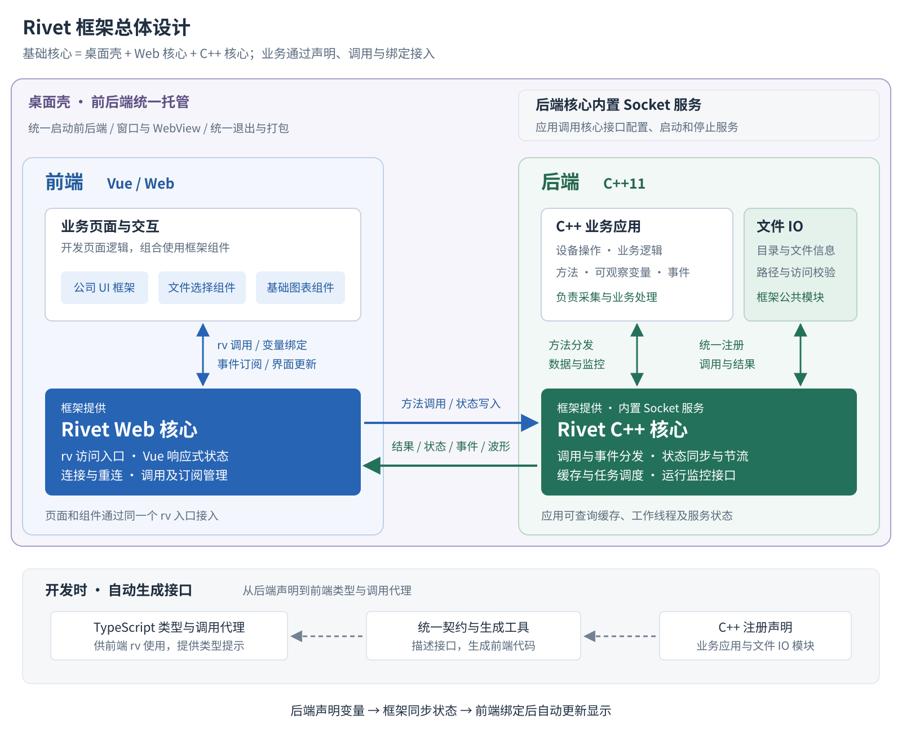

# Rivet 框架需求

## 1. 建设目标

上位机开发需要同时处理设备通信、业务逻辑和界面交互。传统桌面 UI 在布局、样式和交互调整上需要较多投入；直接采用 Web 前端与独立接口服务，又需要反复维护通信接口、前后端类型和数据刷新逻辑。因此，需要一种更简单、灵活、易维护的开发方式。

Rivet 使用 **C++11 处理设备和业务逻辑，Vue / Web 负责 UI 绘制**，由框架统一完成方法调用、变量同步、事件通知和前端类型生成，并提供文件选择、基础图表及符合公司风格的 UI 框架。

期望的开发体验是：后端按约定声明一个可观察变量，前端绑定后，变量变化即可自动同步并更新显示。开发者主要关注业务逻辑和页面交互，减少为每个变量编写接口、轮询和刷新代码的工作。例如：

```vue
<span>温度：{{ rv.device.temperature.value }} ℃</span>
```

通过统一接入方式、可复用组件、项目模板和 AI 编程支持，提高新项目搭建和界面开发效率，降低后续维护成本。

## 2. 总体设计

### 2.1 基本概念与核心思想

Rivet 将桌面运行环境、界面接入和后端接入组织成一套可复用的开发基础。业务应用在此基础上编写页面、设备操作和业务逻辑，通过声明方法、变量和事件连接前后端。

- **桌面壳**：属于框架基础核心，统一托管前端界面和后端程序，提供桌面窗口、WebView、前后端启动与退出协调，以及桌面打包入口。用户启动一个桌面应用，即可同时启动前后端。
- **Web 核心**：运行在前端，通过 `rv` 提供调用、变量绑定和事件订阅，将后端数据变化转为页面更新。
- **C++ 核心**：接入业务方法、可观察变量和事件，处理调用分发、状态同步、节流与缓存，并向应用提供运行监控接口。
- **组件与工具**：文件选择、图表和公司 UI 基于上述基础复用；契约工具连接前后端声明，Skill 辅助开发。

核心思想是**业务按约定声明能力，框架完成连接与同步，界面通过绑定使用数据**。壳、Web 核心与 C++ 核心各自保持清晰边界；更换壳时，业务接入及文件、图表组件继续通过 Rivet 工作。前端也可在浏览器中运行。

### 2.2 架构与数据流向



图中桌面壳是包含前后端的外层托管容器，统一管理启动和退出；内部左侧为 Web 前端，右侧为 C++ 后端，深色区域为两端核心。实线表示运行时交互，底部虚线表示开发时的契约生成流程。

前端业务页面通过 Web 核心调用后端、绑定状态和订阅事件；C++ 核心负责通信与分发，业务应用负责设备和业务处理。方法结果、状态变化和事件沿相反方向返回。

桌面壳将前后端作为一个桌面应用共同托管：启动后端程序并加载前端页面，前端连接后端核心内置的 Socket 服务。文件、图表及公司 UI 通过 Rivet 自身机制接入。

### 2.3 Socket 服务的提供方式

**建议由 C++ 核心内置 Socket 通信服务，应用通过框架接口配置、启动和停止。** 核心负责监听、连接管理、消息收发及通信线程，应用注册业务能力并处理业务逻辑，接入时无需自行实现一套服务。

桌面壳统一启动后端和前端：后端初始化时启动核心服务，前端待服务就绪后建立连接；退出时由壳协调前端关闭、核心服务停止及后端进程退出。核心提供监听地址、端口和服务状态接口，方便应用配置及定位启动问题。

## 3. 功能需求

### 3.1 桌面壳与应用托管

- 交付一种默认桌面壳，每个应用实例托管一个前端窗口和一个后端程序，一次启动同时加载两端；后端服务就绪后，前端自动连接。
- 支持窗口基础配置、页面加载、后端路径及连接地址配置，并提供启动失败和异常退出提示。
- 退出桌面应用时协调关闭前端、停止核心服务并回收所托管的后端进程，避免残留进程。
- 提供 Windows／Linux 环境的桌面运行与打包示例；前后端通过 Rivet 接口协作，便于替换壳。

### 3.2 C++ 核心与 Socket 服务

- 提供 C++11 核心库和内置 Socket 服务，面向桌面应用的本机前后端通信，应用调用框架接口完成配置、启动与停止；多个应用实例通过独立端口运行。
- 核心负责监听、连接管理、消息收发、请求分发、超时和错误反馈，停止时释放连接与相关资源。
- 通过独立线程或线程组处理通信，明确业务回调、对象生命周期和退出顺序，避免耗时业务阻塞通信。

### 3.3 C++ 业务接入与状态同步

- 通过显式注册接口声明业务方法、事件及数据类型，通过框架变量包装接入状态，区分只读和可写状态；支持数值、布尔、字符串、一维列表及显式注册的数据结构。
- 后端变量变化自动同步前端；前端修改可写状态时提交后端处理并反馈结果。
- 高频状态按配置周期合并、批量推送最新值，持续变化时周期更新，变化停止后送达最终值；首次连接及重连时获取最新状态。
- 当前值、命令、事件和波形采用对应的数据处理方式，波形按采样顺序批量传输。设置缓存上限和超限处理规则，控制慢客户端造成的积压。

### 3.4 Web 核心

- 通过统一的 `rv` 入口调用后端方法、绑定 Vue 响应式状态和订阅事件，提供 TypeScript 类型提示。
- 提供自动连接、断线重连、连接状态和调用错误反馈。
- 处理状态更新及订阅释放，供业务页面、文件组件和图表组件复用。

### 3.5 契约生成与开发工具

- 从 C++ 注册信息导出方法、状态、事件和类型契约，生成前端 TypeScript 类型与调用代理；契约导出与业务调用使用同一份注册信息。
- 提供生成和更新命令、基础工程配置及构建说明，使后端声明变化后可以同步更新前端接口。
- 提供声明错误和不支持类型的诊断，减少前后端人工维护接口和类型的工作。

### 3.6 文件 IO 与选择组件

- 后端提供目录浏览、文件信息、类型筛选、路径校验和可访问目录范围配置。
- 前端提供文件单选／多选、目录选择、路径展示、确认／取消和错误提示。
- 返回后端机器可访问的真实路径，组件通过 `rv` 使用 IO 能力；文件内容的读取、保存和数据转换由业务处理。

### 3.7 基础图表组件

- 基于成熟图表库封装独立 Vue 组件包，通过 Rivet 接收数据，提供二维实时折线／波形展示。
- 支持多曲线、坐标轴、曲线名称与颜色、批量追加、滚动窗口及有限显示缓存。
- 提供基础缩放、曲线显隐、暂停／恢复显示；显示暂停与设备采样分别控制。
- 交付一种图表引擎的组件封装和数据接入示例，以本节列出的基础交互为范围；采集、历史数据存储及分析算法由业务处理。

### 3.8 公司风格的 UI 框架

- 提供基于 Vue、现有 UI 组件库和 Rivet 的完整前端模板工程，作为公司上位机项目的开发起点。
- 统一字体、字号、颜色、按钮、间距、表格密度及交互反馈，通过主题配置集中调整。
- 提供应用主布局、导航、内容区、连接／设备状态区，以及**设备概览、参数配置、数据监控三个页面模板**。
- 集成文件选择和基础图表，使通用组件与页面风格一致；模板通过示例数据和接口展示用法，具体设备业务由甲方接入。
- 按甲方提供的界面参考完成一套主题，报价暂按两轮集中视觉调整估算。

### 3.9 前后端应用 Demo

- 提供一个 C++ 后端和一个 Vue 前端，复用公司 UI 模板，演示方法调用、变量读写、事件、节流、文件选择、波形和断线恢复。
- 提供模拟设备数据、构建运行说明和业务接入示例，使甲方可在此基础上并行开发。

### 3.10 AI 编程支持

- 提供框架开发规范、契约说明、组件用法和典型任务示例，帮助 AI 按项目约定编写代码。
- 报价暂按适配甲方一种 AI 编程工具的 **Skill** 估算，覆盖项目接入、添加方法／变量、生成代理、页面绑定及组件使用。
- 本报价交付 Skill 和使用示例；MCP 工具服务按新增功能另行评估。

### 3.11 核心运行监控接口

- 向 C++ 应用提供线程安全的运行快照查询和状态／异常通知接口，便于应用接入日志、诊断页面或告警；查询不依赖前端连接正常。
- **内存相关**：提供核心管理的发送队列、状态缓存等可统计缓冲区的占用、条目数及上限；进程内存作为独立指标，注明统计口径，不能直接视为框架自身内存。
- **线程相关**：提供核心自有工作线程数量、运行／等待／停止状态、待处理任务数及异常记录。
- **服务状态**：提供服务运行状态、连接数、请求处理和错误计数、发送积压等基础指标。指标注明采样时间与可用性，采集频率可配置，控制额外开销。
- 交付指标接口和读取示例；监控页面、告警策略由业务应用接入，线程 CPU 分析等深度诊断能力按新增功能评估。

### 3.12 跨平台验证与交付

- 提供 **Windows x64、Linux x64（glibc）** 的构建与运行验证，每个平台覆盖一种用于甲方项目的系统、编译器和 WebView 组合，环境版本随交付说明列出。
- 完成基本功能联调，交付源码、构建产物、依赖及许可清单、使用文档和运行示例。
- 保持可移植设计并提供构建说明；其他目标平台由甲方自行构建验证，需要乙方适配时另行确认范围。

### 3.13 前后端通信测试与优化

- 结合业务数据，对请求调用、状态推送和波形传输进行测试，分别检查通信、前端数据处理及界面显示中的瓶颈。
- 根据测试结果优化批量推送、编码、缓存和刷新调度，并复测交互及数据同步；具体优化深度根据代表性数据和实测结果评估。

## 4. 开发周期与交付节点

周期以自然日计算，功能开发暂估 **45 天**，通信测试与优化预留 **5 天**，基础时间合计 **50 天**。按 **1.3 风险系数**计算，计划总周期为 **65 天**。

- **第 15 天：接入业务的目标节点。** 提供由桌面壳启动的最小前后端 Demo、C++ 基本接入链路、契约生成流程和说明，在甲方主要开发环境打通方法调用、基础变量、事件及节流，支持甲方开始业务开发。
- **第 65 天：预计完成最终交付。** 完成核心、组件、UI、监控、通信优化、平台运行与打包及交接，排期结合通信原型结果复核。

两个节点从同一起算日计算。通信测试在核心链路打通后尽早开始，与后续组件工作衔接；第 15 天节点代表基本功能可接入，通信容量和优化工作继续在总周期内完成。

第 15 天接入目标按核心链路的交付内容安排，已包含在总周期内。通信测试与优化的 5 天计入基础时间；30% 风险余量统一预留，不在各节点重复叠加。

甲方开始接入后，已确认接口保持稳定；乙方为完成约定功能而调整接口时，提供迁移说明并协助接入调整。最终结合 Demo 和约定功能完成交接验收。

## 5. 维护与新增功能的划分

- **缺陷修复**：已交付功能未达到约定要求，例如变量未同步、操作异常等，按原功能范围修正。
- **使用支持**：提供基本使用说明和框架接入答疑；设备驱动、业务算法及具体业务页面由甲方开发。
- **新增功能**：增加功能、页面、平台支持或扩大原有使用范围，先评估时间与费用，再确认实施。新增需求不会自动纳入原报价。

交付以第 3 节功能清单和对应运行示例为依据。公司 UI 按一套主题、三个页面模板和两轮集中视觉调整交付，组件按各自列明的功能交付。

## 6. 开发时间与报价评估

按各工作项估算开发时间，通信测试与优化单独列项。计价采用月薪 14,000 元、每月 22 个工作日折算日单价，再乘以包含风险余量的估算工作量；交付节点仍按第 4 节的自然日周期安排。

| 对应章节 | 功能／工作项 | 基础开发时间（天） |
| --- | --- | ---: |
| 3.1 | 桌面壳与前后端统一托管 | 3 |
| 3.2 | C++ 核心与内置 Socket 服务 | 7 |
| 3.3 | C++ 业务接入与状态同步 | 7 |
| 3.4 | Web 核心适配 | 3 |
| 3.5 | 契约生成与开发工具 | 4 |
| 3.6 | 文件 IO 与选择组件 | 3 |
| 3.7 | 基础图表选型、封装与接入 | 4 |
| 3.8 | 公司 UI 主题、布局及三个页面模板 | 5 |
| 3.9 | 前后端 Demo 与接入示例 | 2 |
| 3.10 | AI 编程 Skill 与使用说明 | 1 |
| 3.11 | 核心运行监控接口与读取示例 | 2 |
| 3.12 | 平台运行、打包联调、文档与交接 | 4 |
| 3.13 | 通信测试、瓶颈定位、优化与复测 | 5 |
| **基础合计** | **功能开发与通信测试优化** | **50** |
| 风险余量 | 基础时间 × 30% | 15 |
| **计划总周期** | **50 × 1.3** | **65** |

通信工作预留 5 天，暂分为测试与定位 2 天、优化 2 天、复测 1 天；根据实际瓶颈统筹安排。

**报价计算：14,000 ÷ 22 × 50 × 1.3＝41,363.64 元。**

日单价约 636.36 元，基础工作量 50 天，含 30% 风险余量后按 65 天计价。金额使用未舍入的日单价计算，最终保留两位小数；风险余量已包含在报价中，不再额外加收。

**项目开发报价初稿：人民币 41,363.64 元。** 第三方商业图表库等授权费用单列。付款可按启动、接入版本交付、最终交付三个节点安排。
