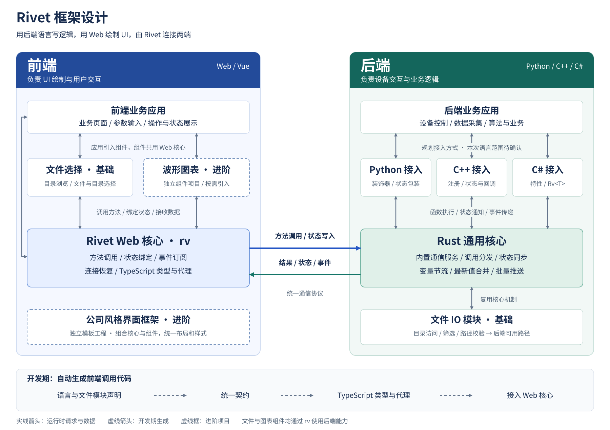

# Rivet 框架需求

## 1. 建设目标

**实际痛点**：上位机开发常由同一位开发者同时负责设备、业务和界面。使用 .NET + Avalonia、Python / C++ + Qt 等方案时，除了设备逻辑，还要在界面布局、样式、交互和状态维护上投入大量精力；直接采用 Vue + WebAPI，又增加了接口、前后端类型和通信维护工作。因此，需要寻找一种更简单、灵活、易维护的上位机开发方式，Rivet 正是基于这些实际问题提出的方案。

**建设方向**：使用 Python、C++、C# 等后端语言处理设备交互和业务逻辑，使用 Web 技术绘制 UI。通过通用核心和语言接入包，后端声明方法、状态和事件，前端通过统一的 `rv` 调用和绑定，由 Rivet 负责通信、契约生成和状态同步。

**预期收益**：提高界面布局、视觉调整和交互开发的效率，减少重复的通信代码，让不同语言的后端复用同一套前端接入方式与组件。配合项目模板及 AI 编程支持，降低新项目搭建、人员上手和后续维护成本。

**理想状态**：后端按框架约定暴露一个变量，前端完成一次绑定后，后端变量变化即可自动同步，由 Vue 更新对应显示。开发者负责页面布局和业务逻辑，无需为每个变量编写接口、轮询或手动刷新代码；方法直接调用，文件和图表复用组件，AI 根据框架规范与项目契约辅助开发。

例如，后端更新“当前温度”变量后，下面的页面显示会自动更新：

```vue
<span>温度：{{ rv.device.temperature.value }} ℃</span>
```

## 2. 框架设计



框架分为前端和后端两部分：

- **前端**：业务应用负责页面和交互；Web 核心提供 `rv`、连接管理和响应式状态；文件、图表等组件基于 Web 核心使用后端能力。
- **后端**：业务应用负责设备与业务；语言接入包负责各语言的方法、变量和事件；Rust 通用核心负责通信服务、调用分发、状态同步与节流，并提供文件 IO 能力。

方法调用从前端经 Web 核心、Rust 核心和语言接入包到达业务应用；执行结果、状态变化和事件沿相反方向返回。各语言声明生成统一契约，再生成前端类型与调用代理。

通用核心由各语言复用，应用使用对应语言的接入包。文件、图表等组件通过 Rivet 自身机制连接前后端，应用无需为组件另写通信代码；这些能力不依赖特定桌面壳。

## 3. 基础功能

### 3.1 Rust 通用核心

- **内置通信服务**：应用初始化框架后，由核心启动服务并管理连接，支持端口配置及多个应用同时运行。
- **独立运行通信任务**：优先采用进程内独立线程或线程组，避免耗时业务操作阻塞通信；应用退出时统一释放资源。
- **调用与事件分发**：将前端请求交给对应语言的业务函数，返回结果或错误，并推送业务事件。
- **公共能力扩展**：提供统一注册与调用机制，让文件 IO 等模块复用核心，供不同语言应用使用。

### 3.2 状态同步与节流

- **双向同步**：后端状态变化自动更新前端；前端修改可写状态后传回后端，反馈处理结果。
- **状态合并**：变量变化过快时，按配置周期推送最新值，支持多个变量批量更新；变化停止后保留并送达最终值。
- **连接恢复**：首次连接和断线重连后获取最新状态，让页面恢复到当前业务状态。
- **数据分类处理**：当前状态可以合并；事件和命令分别处理；波形按采样序列传输，不能只留下最后一个点。推送节流不改变设备采样和业务处理。
- **缓存控制**：限制待发送数据的缓存，避免前端处理缓慢时数据持续积压。

### 3.3 Web 核心与开发工具

- **统一前端入口**：通过 `rv` 调用后端方法、绑定状态、订阅事件，提供 TypeScript 类型提示。
- **连接管理**：自动连接、断线重连、连接状态展示及调用错误反馈。
- **契约与代理生成**：根据各语言和公共模块的声明生成统一契约，再生成前端类型与代理，减少重复维护接口和类型。
- **开发接入**：提供基本生成命令、契约更新和 Vue 工程接入方式。Web 核心专注通信和状态，组件与界面项目依赖它。

### 3.4 语言接入能力

规划的语言接入方式如下。各接入包提供方法调用、可观察状态、事件通知和契约导出，并处理类型转换、异常和运行生命周期；本次需要实现的语言及版本在第 5 节确认。

- **Python**：通过装饰器、状态包装等方式接入，支持业务函数与状态变化通知。
- **C++**：通过注册接口、状态包装等方式接入，处理回调、线程与内存资源。
- **C#**：延续特性声明和 `Rv<T>` 的使用方式，支持异步方法，适配现有契约生成能力。

### 3.5 文件 IO 与选择组件

- **后端 IO 模块**：提供目录浏览、文件信息、类型筛选和路径校验，配置可访问的目录范围。
- **前端选择组件**：提供文件单选、多选和目录选择，以及路径显示、确认、取消和错误提示。
- **真实路径交给业务**：返回后端机器上可访问的文件或目录路径，供后端业务继续处理。
- **通过框架自身实现**：Rust 侧统一实现 IO，前端组件通过 `rv` 调用；各语言应用引入组件后直接使用，无需依赖桌面壳或另建接口。

### 3.6 基本应用 Demo 与跨平台运行

- 提供一个基础 Vue 前端 Demo，按本次确认的语言分别提供后端 Demo，演示同一套前端连接不同语言后端。
- 演示方法调用、状态读写、高频变量节流、事件、文件选择和断线恢复，并提供基本运行与接入说明。
- 保持跨平台设计，在确定的操作系统和语言版本上支持构建与运行。

### 3.7 AI 编程支持（Skill / MCP）

- **提供 AI 接入能力**：提供 Skill 或 MCP，按所用 AI 编程工具和实际需求选择。Skill 提供开发规范与示例，MCP 可提供项目上下文查询和开发工具调用能力。
- **理解框架与项目**：让 AI 获取框架结构、当前契约、方法和状态类型、组件用法及示例，按实际可用能力编写代码。
- **辅助常见开发任务**：指导 AI 搭建项目、添加后端方法与状态、生成前端调用和页面、接入文件及图表组件，并执行相应生成与构建流程。
- **减少重复说明与错误接入**：让 AI 遵循项目约定，复用 `rv` 和已有组件，修改声明后更新契约与代理，并根据错误信息辅助定位问题。

## 4. 扩展组件与界面框架

### 4.1 波形图表组件

- **独立组件项目**：基于 Rivet Web 核心封装为独立 Vue 组件包，由前端应用按需引入；通过 `rv` 接收后端数据，图表实现与依赖放在组件项目中。
- **复用成熟图表库**：保留开源和商业方案，后期根据功能与数据规模选型。
- **实时波形展示**：支持多曲线、数据追加、滚动窗口、缩放、平移、曲线显隐和暂停／恢复显示。
- **数据处理**：封装批量更新、有限缓存和显示刷新调度，按需要加入降采样，保留业务关注的波形特征。

### 4.2 公司风格的上位机 Web 界面框架

- **独立前端模板工程**：基于 Vue、Ant Design Vue 和 Rivet，组合核心与组件，作为新上位机项目的开发起点。
- **默认布局与页面**：提供导航、内容区、连接和设备状态，以及参数表单、操作区域和数据列表等常用页面结构。
- **统一视觉风格**：按公司习惯统一字体、字号、按钮、颜色、间距和表格密度，通过主题配置集中调整。
- **组件集成**：接入基础文件组件，并支持引入波形组件，使组件与业务页面的操作和样式保持一致。

## 5. 需要讨论与确认的事项

### 5.1 跨平台范围与构建分工

建议首期由开发方提供构建产物及运行验证的平台为：

1. **Windows x64**。
2. **Linux x64，glibc 环境**。

需进一步确定 Windows 版本、Linux 发行版与最低 glibc 版本，以及各语言的工具链和前端浏览器环境。公司提供实际使用环境或对应测试环境，确认核心、所选语言接入包和组件的运行组合。

**其他平台的建议分工**：开发方保持核心和接入层的可移植设计，提供源码与构建说明；其他目标平台由公司自行构建和验证。需要新增的平台适配与问题排查另行确定承担方，不将尚未验证的平台写成已保证可用；已约定平台上的框架缺陷仍由开发方处理。

### 5.2 语言接入范围

- **需要哪些语言**：本次是否只实现 Python、C++？C# / .NET 接入是否需要纳入，还是保留现有方案、后续再适配？
- **每种语言支持到什么程度**：确认方法调用、状态包装、事件、同步／异步及常用数据类型；由公司提供代表性业务代码，明确希望保留的编程方式。
- **版本与实现分工**：确认 Python 版本、C++ 编译器，以及需要 C# 时的 .NET 版本；哪些接入包由开发方完成，哪些由公司基于公共接口自行扩展？

### 5.3 组件与界面分工

- **图表组件由谁实现**：由开发方选型并完成独立组件封装，还是由公司使用 Rivet 数据接口自行开发？开源／商业选型及功能范围随后确认。
- **公司界面框架**：由谁负责默认主题、布局和页面模板？公司需提供界面参考及常用操作习惯。
- **文件 IO 范围**：是否只需要目录浏览和路径选择，还是还需内容读写、保存路径等操作？

### 5.4 运行、性能与 AI 接入

- **运行方式**：核心在业务进程内独立调度是否足够？是否确实需要独立进程、接入已有服务或远程访问？
- **实际数据规模**：公司提供变量数量、更新频率、同时连接数，以及需要图表时的通道数和采样量，用于确定节流和显示要求。
- **AI 工具支持**：公司使用哪些 AI 编程工具？本次提供 Skill 是否足够，哪些操作需要通过 MCP 查询项目或调用开发工具？
